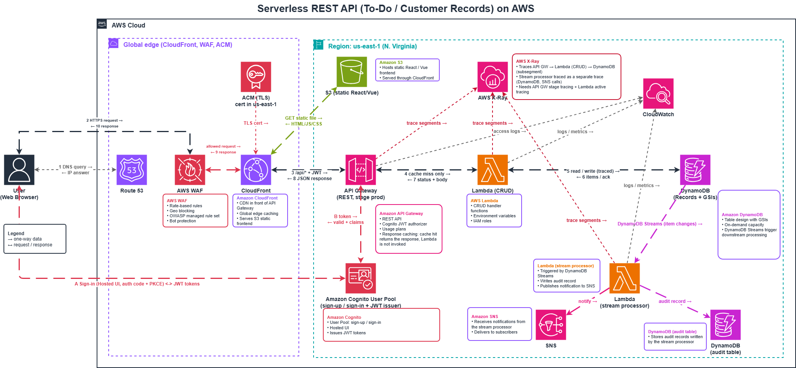

# Serverless REST API on AWS

Serverless REST API with Cognito Auth, DynamoDB & WAF

## About the Project

This project is a REST API for managing To-Do / Customer records. It is fully serverless, so there are no servers to manage and you pay only for what you use.

Users open a website, sign in, and create, read, update or delete their records. Everything runs on AWS in the `us-east-1` (N. Virginia) region.

## Architecture

## How It Works

1. The user opens the website. Route 53 finds the address.
2. The request goes through AWS WAF (security checks) to CloudFront.
3. CloudFront shows the web page from S3, or sends API calls to API Gateway.
4. The user signs in with Cognito and gets a login token. API Gateway checks this token on every call.
5. API Gateway runs the Lambda function, which reads or writes the data in DynamoDB.
6. The answer goes back to the user.

When a record changes, a second Lambda function saves an audit record and sends a notification with SNS.

## AWS Services

- **Route 53**: Connects the domain name to the website.
- **AWS WAF**: Blocks bad traffic, like too many requests or known attacks.
- **ACM**: Gives the website its HTTPS certificate.
- **CloudFront**: Delivers the website and API fast from locations around the world.
- **S3**: Stores the website files (React / Vue).
- **API Gateway**: The front door of the REST API. It checks the login token and can cache answers.
- **Cognito**: Handles sign-up and sign-in.
- **Lambda (CRUD)**: Runs the code to create, read, update and delete records.
- **DynamoDB**: The database that stores the records.
- **Lambda (stream processor)**: Reacts to record changes, writes the audit record and sends the notification.
- **DynamoDB (audit table)**: Stores the audit records.
- **SNS**: Sends the notifications.
- **X-Ray**: Shows the path of a request from API Gateway to Lambda to DynamoDB.
- **CloudWatch**: Keeps the logs and metrics.

